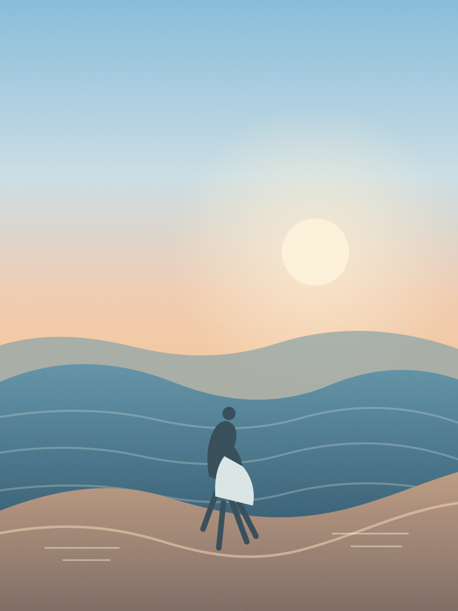

  
  <h1>FramedLocal</h1>
  
<strong>A thoughtful iPhone camera. Private by design.</strong>

  

    <a href="https://mithundb.github.io/FramedLocal/">Open the interactive project site</a>
    ·
    <a href="docs/PROJECT_STATUS.md">See project status</a>
  

  

FramedLocal is a local-first camera and photo editor for iPhone. Compose with optional on-device guidance, choose an original film look, and export a new JPEG while keeping the source photo unchanged.

## What it does

- **Compose:** front and rear cameras, supported lens switching, a smooth zoom dial, tap focus/exposure, and optional subject framing and guidance.
- **Shape:** Natural, Warm Print, Soft Mono, Faded Color, and Night Grain looks; Original, Square, 4:3, and 16:9 crops; optional borders and date stamp.
- **Keep it yours:** on-device processing, add-only Photos access, and a separate exported copy. No cloud AI, photo uploads, analytics, or network dependency in the app.

The website preview uses a sample illustration only. It never accesses a visitor’s camera. The app is in development and is not distributed as a public download yet.

## Build locally

Open `FramedLocal.xcodeproj` in Xcode and run the `FramedLocal` scheme on an iPhone or simulator. The app uses AVFoundation, Vision, Core Image, Metal, and PhotoKit on-device.

For current implementation details, verification results, known limitations, and the next step, see [`docs/PROJECT_STATUS.md`](docs/PROJECT_STATUS.md).
